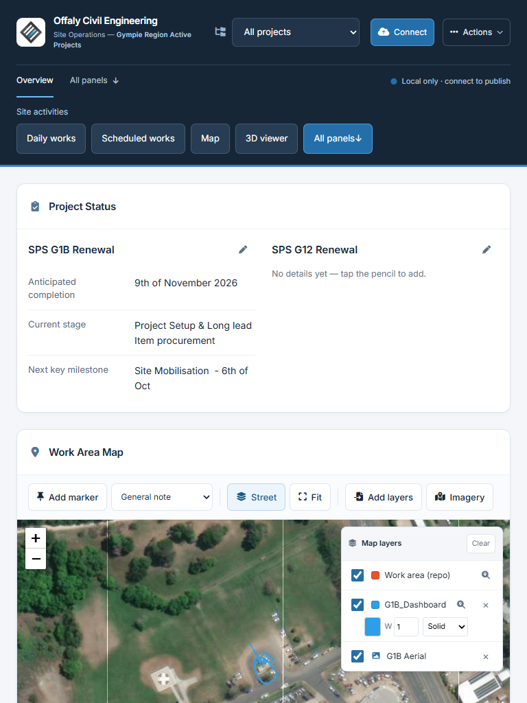

# Final Phase 1 release-readiness refinement

Continues the approved Phase 1.1 commit `d610b4a6c6fef3c80f454da7e942b9a20f817bd5`. PR #1 remains a draft. Owner review is required before merging or deployment. Phase 2 has not started.

## Design

At portrait-tablet widths (681–1100 px), existing Project Status moves above the map. Daily works, Scheduled works, Map, 3D viewer and All panels are directly accessible from the header. The empty 3D hint is compact; the viewer and upload controls remain available. Desktop, landscape-tablet and phone arrangements stay as approved. CSS changes are screen-only, preserving the document and print order. Shortcuts target the existing audience-filtered panels.

[Desktop 1440 × 900](release-desktop.png) · [Mobile 390 × 844](release-mobile.png) · [Import confirmation](release-import.png)

These are actual browser captures using a clone of operational data, synthetic weather and isolated test keys. The illustrated map is focused through the existing G1B layer control, as in the Phase 1.1 review. The final review package also includes untouched default landing captures showing the broader sample-layer extent.

## Import safety

`index.html` changes only `importData()`, `normaliseBackup()` and a new confirmation dialog relative to the approved commit. It explains full-board replacement, loss of unpublished local changes, retained GitHub connection and explicit-only publishing. A current-board JSON download and acknowledgement that it was saved are required before replacement. If the board changes after download, or publishing is in progress, the import is stopped and must be restarted.

Valid backups still restore every state section and preserve unknown/legacy fields. Missing legacy projects/clients receive existing defaults; explicitly empty arrays are rejected rather than silently repopulated on reload. Missing IDs/names/client keys, duplicate IDs, malformed panel records, attachments, visibility flags, model references, nested record containers and invalid map geometry are rejected before confirmation. Unknown extension fields remain local under the existing publishing whitelist. Historical/default project references already present in saved data are not migrated or deleted.

Fallible storage, board rendering and map work complete before cached model geometry is touched. Rollback restores the original state, exact affected storage values, publishing flags, project selection, actual map-layer objects, centre and zoom. Failed imports do not start candidate model loads or reframe the existing scene. Session model geometry is retained on successful import too. Imported models can still fail to load if their external URL is unavailable; JSON validation cannot guarantee remote availability.

Downloaded pre-import JSON can be imported to undo a successful restore. It contains the whole saved board, including attachment references and unpublished changes, but not attachment binaries or session-only uploads. Keep those original files. If the browser itself refuses a rollback write, the application explicitly reports incomplete recovery and directs the user to the downloaded backup rather than claiming success.

## Preserved sample GeoJSON: assessment and options

The root `workarea.geojson` is the existing four-feature `workarea_sample`, around longitude 153.083–153.090, latitude −25.905. Its sample work area is near Rainbow Beach. The saved G1B vector layer is around longitude 152.653, latitude −26.188. The root file, loader and Fit implementation are unchanged in this refinement.

The base layer is global: it is shown for all project selections and editor/site/client views, including a client without an assigned project. The saved G1B vector/imagery layers are also currently global; changing the project dropdown filters operational records and markers, but does not scope those layers. Viewer layer switches change the current view, not access permissions. Client printing still omits the map as before.

Fit correctly includes all visible geometry, so the distant sample broadens the extent. In the targeted 1440 px check after selecting the second project, Fit is zoom 10 with the sample and zoom 20 without it; other selections/visible markers can produce different extents. The root layer has an existing independent visibility switch and zoom control. Hiding it is session-only and loading the page again restores its default visibility.

| Option | Consequence |
| --- | --- |
| Keep current behaviour | No data/behaviour change, but the sample stays visible to every audience and broadens Fit. |
| Relabel it as a reference/sample and default it off | A small future presentation change can retain one-click access and preserve the original file. Requires approval because default visibility changes. |
| Associate layers with projects and audience rules | Recommended operational destination: show the selected project's approved layers and fit only those visible layers; retain the sample as an optional reference. Requires an explicit metadata/migration design and separate regression review, not this release refinement. |
| Replace the root file with an approved project layer | Suitable for a single-project board, but would change a preserved operational asset and still would not provide multi-project scoping. Requires owner approval. |

Recommendation: approve the reference/sample labelling and default-off behaviour as a separate small change if desired; then plan explicit project-associated layers separately. Do not infer project assignment from filename or proximity. No layer was deleted, altered, hidden by default or silently reassigned here. Audience filtering is display-only; it does not make a public repository a secure client data store.

## Verification and recovery

The repeatable suite has 83 checks covering the original 21 panels, CRUD/history, Settings, projects/clients, site/client views, mapping/projection/raster/imagery, actual G4N and other model formats, files/photos, printing, local storage, intercepted publishing and the new safety cases. Chromium exports five baseline/candidate report PDF pairs; Firefox runs the same functional and print-media assertions without unsupported PDF export. Source checks retain original hooks, print styles and business code outside the previously isolated repair functions. All GitHub writes in tests are intercepted; production publishing is never performed.

Final exact-commit results, clean-tree metadata, screenshots, PDF comparisons and CI links are delivered with the PR review package. The read-only CI workflow checks the exact PR head in Chromium and Firefox and retains evidence for 14 days. `tests/recovery.cjs` builds a complete bundle with no prerequisite commits plus a ZIP of every tracked source/attachment, then performs an offline clone, `git fsck --full`, and a byte check of every restored tracked file.

Operational baseline is freshly fetched `origin/main`; the preservation manifest compares all 181 data/assets by Git identity and records working-file SHA-256 hashes. `data.json` and all attachments are unchanged. The full recovery bundle includes both the reviewed candidate and main history; it is not an incremental patch. Browser-local unpublished edits require the separate application Export. CDN libraries, external map tiles and hosted resources remain network dependencies; repository recovery does not make them offline services.

## Limits

- Physical tablets/phones and Safari are not tested. The installed Android 15 Pixel Tablet emulator booted, but Chrome remained at first-run setup without the command-line flag required for Playwright attachment. No Android application test passed; no first-run terms were accepted. See [Playwright Android prerequisites](https://playwright.dev/docs/api/class-android). Desktop touch emulation is labelled separately.
- Native browser/Android print dialogs and real production publishing permissions/writes remain untested. Chromium PDF and Firefox print-media checks are automated evidence, not physical-printer acceptance.
- The existing 63-page full-board report and other print spacing are preserved, not redesigned. G4N remains an eight-mesh, 5,880-triangle utility network; its existing Y-up control gives the illustrated upright orientation. The referenced MTL is absent and neutral materials remain.
- Validation strengthens import deliberately; malformed partial exports are rejected instead of being silently repaired. Structurally valid legacy backups and unknown fields remain supported. JSON recovery retains references, so external attachments must remain available or be restored from the full repository archive.

## Precise source scope

| Files | Change |
| --- | --- |
| `ui-v2.css`, `ui-v2.js` | Portrait-tablet hierarchy, spatial anchors, compact empty viewer. |
| `index.html` | Confirmation markup; `importData()` transaction/recovery boundary; `normaliseBackup()` validation. |
| `tests/readiness-checks.cjs` | Targeted tablet, import, rollback and unchanged GeoJSON scope cases. |
| `tests/backup-checks.cjs`, `tests/phase11-checks.cjs` | Confirmation-aware round trips and visible phone-shortcut assertions. |
| `tests/harness.cjs`, `tests/regression.cjs` | Firefox selection/metadata, application-ready wait, print-media/PDF separation and original delayed marker-focus synchronisation. |
| `tests/capture.cjs`, `tests/preservation.cjs`, `tests/recovery.cjs` | Actual default captures, raw working-file hashes and exercised standalone recovery. |
| `.github/workflows/review-checks.yml`, `tests/README.md` | Repeatable Firefox and complete-recovery checks and instructions. |

No new runtime framework, data schema, navigation rewrite, publishing field list or map-layer policy is introduced.
