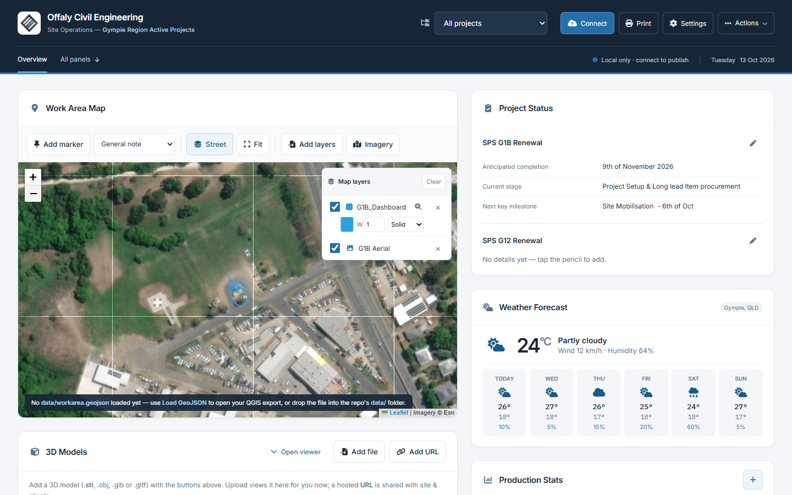

# OCE-OPS — Phase 1 interface review

**Review candidate only. Do not merge or deploy until the owner approves the design.**

The screen interface now uses a restrained navy header, blue actions, Inter typography,
white cards and quieter status hierarchy. The desktop map and expandable 3D viewer form
one column; project status, weather and production figures occupy the other. Mobile
commands wrap within the viewport, and editing/visibility controls remain visible on touch.

## Screenshots

These are actual Chromium captures of the application, not design mockups. The existing
149-item dataset was cloned into an isolated test context. Weather is deterministic test
data and audience links use test keys. Map captures use the existing layer's location at
satellite zoom 18, where real imagery is available. The RFI screenshot contains a temporary,
unsaved example. No screenshot required changing operational data.

| View | Before | After |
| --- | --- | --- |
| Desktop, 1440 × 900 | [Original](before-desktop.png) | [Redesigned](after-desktop.png) |
| Mobile, 390 × 844 | [Original, 489 px document width](before-mobile.png) | [Redesigned, 390 px document width](after-mobile.png) |
| Tablet, 768 × 1024 | — | [Redesigned](after-768x1024.png) |
| Operational panels | — | [Desktop](panels-1440x900.png) / [Mobile](panels-390x844.png) |
| Settings | — | [Desktop](settings-1440x900.png) / [Mobile](settings-390x844.png) |
| RFI entry | — | [Desktop](rfi-1440x900.png) / [Mobile](rfi-390x844.png) |
| Read-only audiences | — | [Site](site-view.png) / [Council client](client-1-view.png) |
| 3D import | — | [Existing G4N.obj loaded](model-obj.png) |

## Scope and architecture

- Active runtime: static GitHub Pages; original inline JavaScript and CSS in `index.html`.
- Phase 1 adds `ui-v2.css`, loaded for screen media only, and `ui-v2.js` for responsive
  command placement, model disclosure, control labels and dialog focus.
- The original application script and inline stylesheet are byte-identical after line-ending
  normalisation. All original static IDs and action hooks remain present.
- Retained all 21 panels, project/client scoping, S/C flags, history and retirement rules,
  map/3D loaders, attachment/photo workflows, storage and GitHub publishing semantics.
- Added simple Overview/All panels anchors. Grouped workspaces, sidebar routes, schema
  changes and a Settings information-architecture rewrite are outside this phase.
- `app.js` and `styles.css` at the repository root are legacy files, not runtime inputs.
  No framework, backend or mandatory build step was introduced.

## Baseline and recovery

Baseline: [`bee28796bb00f860d17b723d6a3c0b01bd5f4101`](https://github.com/mpb029/OCE-OPS/commit/bee28796bb00f860d17b723d6a3c0b01bd5f4101).
Work is isolated on `ui/phase1-modernisation`; a full local Git bundle preserves the original
history. To inspect the original independently, create a checkout/worktree at that commit.

`data.json`, `files/`, `aerial/`, `G4N.obj` and `workarea.geojson` were not changed.
The unchanged repository `data.json` Git-blob SHA-256 is:

`0e2310fe1d07573b4cea10ca335afd76b545a34952abebbed02665ca7fe45d36`

The Windows checkout uses CRLF and retains its original SHA-256:
`4a23e29f6a58aaba8724f4fea6fe2d9978f8344d65f8f526ab080a6ee842e097`.
The cross-platform test normalises line endings before comparing the repository hash.

## Regression evidence

**62 automated checks: 61 PASS, 1 KNOWN BASELINE DEFECT, 0 new failures.**
See [individual results](regression-results.json). Focused reruns replace earlier results
for the same named scenario. This is not an unconditional acceptance of every original feature.

| Area | Evidence |
| --- | --- |
| Responsive layout | 1920×1080, 1440×900, 1366×768, 1024×768, 768×1024, 390×844, 375×812 and 360×800. All 21 panels reachable; document width equals viewport; menus and dialogs remain within the screen. |
| Editing | Add/edit/delete across 19 ordinary panel types; special fields, references, dates, status, priority, teams and duration; remaining files/photos panels exercised separately. |
| Settings | All mounted fields retained; clients and projects added, renamed, assigned and removed in test state; location/CRS, dummy publishing config and password set/clear compared with baseline. |
| Lifecycle | Completion, active sorting, 24-hour retirement, history retention/CSV, original identifiers and legacy `subbiesTomorrow` data retained. |
| Audience views | Site, both configured clients and unknown-client fallback compared with baseline; project and item/panel/marker/stat visibility; lock/unlock; read-only refresh after 45 seconds and changed-panel ordering. |
| Map | Marker add/edit/drag/delete/cancel and tie-in letters; real Leaflet/proj4; GeoJSON and MGA56 conversion; styles, visibility, layer zoom, street/satellite and imagery URL controls; real GeoTIFF parse and session-layer removal. |
| 3D | Real OBJ/STL and hosted test GLB/GLTF loaders; orbit/pan/zoom/reset/up-axis/fullscreen, collapse/resize, visibility/removal, session versus shared state, site/client view controls. |
| Files/photos | Upload/download/delete using intercepted GitHub responses; 25 MB constraint; photo evidence, weekly folders and ZIP output with real JSZip. |
| Persistence/publishing | Local edits survive reload; baseline state and publish payload match; dummy GitHub success/rejection and dirty/clean states; token excluded from shared data. Backup import defect separately reproduced. |
| Keyboard | Visible focus, dialog names, focus containment, Escape/cancel, focus restoration and touch-visible actions. |

### Actual PDF comparison

Baseline and revised PDFs have identical text on every corresponding page and identical
page counts. Original print CSS remains intact. See [comparison data](print-comparison.json).

| Report | Before | After |
| --- | ---: | ---: |
| Complete board | 63 pages | 63 pages |
| Daily Works | 1 page | 1 page |
| Punch list | 1 page | 1 page |
| Selected weekly photo folder | 7 pages | 7 pages |
| Council client | 2 pages | 2 pages |

A separate synthetic punch item with an existing photo verified the numbered checklist,
Comments line and labelled photo appendix. Printed client reports retain map/weather exclusions.

## Known issues and practical limits

1. **Existing backup import loses data.** Both original and revised code omit `projects`,
   `clients`, `models`, `history`, `panelMeta`, `projectSummary` and unknown top-level keys
   when importing. Export contains the current state, but Import is not a safe full restore.
   This was not silently repaired inside a visual-only change. A separate reviewed data fix
   is needed before relying on operational backup restoration.
2. **Existing base-GeoJSON path mismatch.** The app requests `data/workarea.geojson`; the
   repository contains root `workarea.geojson`. The visible warning and 404 remain. Saved
   user layers and their controls were tested successfully.
3. **Existing map-wide Fit defect.** A separate before/after diagnostic moved the map to
   latitude/longitude 0, zoom 2, then clicked Fit with all 18 saved markers present. Both
   versions stayed there. The marker layer is a Leaflet `LayerGroup` without `getBounds`,
   and the existing bounds error is swallowed. Individual vector-layer zoom works.
4. **Existing imagery coverage/zoom limits.** The satellite layer has max zoom 19; the saved
   vector's layer-fit can reach 20. The imagery service returned unavailable tiles at 19
   for this location and real imagery at 18. Existing tile paths/options were retained.
5. **Existing print spacing.** The selected photo report starts with a heading-only page;
   the supplied full board spans 63 pages. Both are identical before/after and were retained
   under the Phase 1 screen/print separation requirement.
6. **Verification environment.** Chromium with mouse, keyboard and emulated touch; no physical
   iOS/Android or Safari/Firefox run. Weather responses and GitHub API writes were intercepted.
   Real authentication, network permission failures and writes to a controlled GitHub test
   repository were not exercised. No live board Publish operation was performed.

The design is ready for critical review. Overall release acceptance remains subject to owner
approval and the disclosed data-integrity/test limitations. No merge, deployment or Phase 2
implementation is included.
